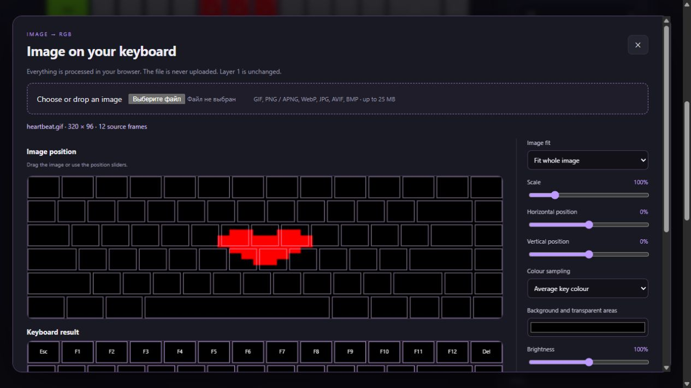

# GIF or image on your keyboard

[Русский](IMAGE_IMPORT.md) · [Editor](https://hikei1337.github.io/cidookeyboardanimations/studio.html#import-image) · [Animation guide](CUSTOM_ANIMATION.en.md)

From **1.9.0**, the editor converts images into RGB frames. A still image becomes static lighting; GIF, APNG and animated WebP become looping animations. PNG, JPG, AVIF and BMP are also supported when Chrome can decode them.

## 1. Choose a file

Click **Import GIF / image** below the keyboard. Choose a file or drag it onto the dashed area. Wait for decoding to finish. Processing stays in your browser; the image is never uploaded to a server.

The upper preview shows your image with key outlines. The lower preview shows the colour each key will receive. Each key displays one colour, so simple silhouettes, large symbols and pixel art work best. Small text and photographs lose detail.

## 2. Fit the image

- **Fit whole image** preserves proportions and shows the entire image. Empty space uses your background colour.
- **Fill and crop** preserves proportions and fills the keyboard; edges may be cropped.
- **Stretch to keyboard** fills the width and height, changing the proportions.
- **Scale** changes the image size. Drag the upper preview or use the position sliders to move it.
- **Average key colour** blends the area covered by each key. **Centre pixel** suits crisp pixel art.
- **Background** fills transparent areas and space around the image. Black stays RGB 0/0/0. At 100% brightness and contrast, pure red stays RGB 255/0/0.

## 3. Set animation timing

Click **Play** or move the time slider. **Start** and **End** select a clip in seconds. **Frames per second** sets motion detail: 8 by default, up to 20. The summary shows the output frame count, duration and effective rate.

Output is limited to 120 frames. For example, a 30-second clip requested at 20 FPS becomes 120 frames of 250 ms each, or 4 FPS, while still lasting 30 seconds. Trim a longer animation for smoother motion. Timing controls are hidden for still images.

## 4. Create and play

Click **Create frames**. This replaces the current project; **Undo last change** restores the previous one. Fitting an image does not alter the project before you apply it. Running hardware lighting stays unchanged until you click **Run on keyboard** again.

The imported project uses **Custom frames** and **Instant** transitions, avoiding extra blending between images. You can paint individual keys, change frame durations and playback speed, add key reactions, save to the library or export JSON. The original file is not stored in the project: you edit RGB frames after importing. Reopen the source file to fit the image again.

The website offers preview and JSON export. For hardware playback, import in the installed extension's editor, or open the exported JSON there. Connect the keyboard, then click **Run on keyboard**. All writes target Layer 2; Layer 1 remains the source.

## Limits

Use an up-to-date Chrome: animated images require the built-in ImageDecoder. Limits are 25 MB, 20 megapixels per image and 600 source frames. If decoding fails or a limit is exceeded, try reducing the image size or animation length. Keyboard-model compatibility is unchanged.
