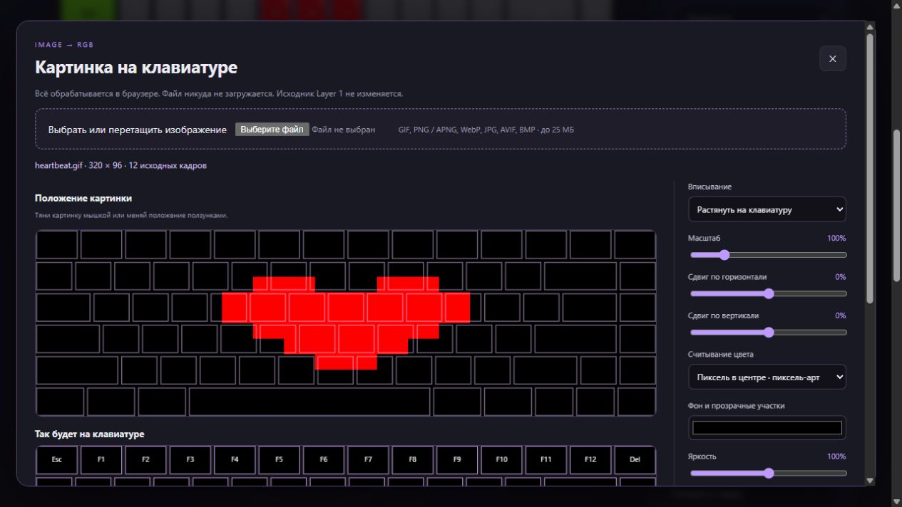

# GIF или картинка на клавиатуре

[English](IMAGE_IMPORT.en.md) · [Конструктор](https://hikei1337.github.io/cidookeyboardanimations/studio.html#import-image) · [Основной гайд](CUSTOM_ANIMATION.md)

Начиная с версии **1.9.0**, конструктор умеет превращать изображения в RGB-кадры. Обычная картинка становится неподвижной подсветкой, а GIF, APNG и анимированный WebP — зацикленной анимацией. Поддерживаются также PNG, JPG, AVIF и BMP, которые умеет декодировать Chrome.

Для первого раза попробуй [50 готовых GIF из интернета](https://hikei1337.github.io/cidookeyboardanimations/gif-examples/): у каждой есть ссылка на оригинал, источник и предпросмотр на клавишах. JSON создаётся из того же исходного GIF. Для результата как на карточках выбери «Растянуть», 100%, «Пиксель в центре», чёрный фон и 8 кадров/с.

## 1. Выбрать файл

Нажми **Импорт GIF / картинки** под клавиатурой. Выбери файл или перетащи его в пунктирную область. Подожди окончания чтения кадров. Картинка обрабатывается в браузере: на сервер она не отправляется.

Верхний предпросмотр показывает изображение и рамки клавиш. Нижний — цвета, которые получит каждая клавиша. Это не маленький экран: одна клавиша показывает один цвет. Наиболее читаемы простые силуэты, крупные символы и пиксель-арт; мелкий текст и фотографии теряют детали.

## 2. Подогнать по клавиатуре

- **Вместить целиком** сохраняет пропорции и показывает всё изображение. Свободное место заполняется выбранным фоном.
- **Заполнить с обрезкой** сохраняет пропорции и заполняет клавиатуру; края могут уйти за границу.
- **Растянуть на клавиатуру** занимает всю ширину и высоту, меняя пропорции.
- **Масштаб** увеличивает или уменьшает рисунок. Перемещай его мышкой в верхнем предпросмотре либо ползунками положения.
- **Средний цвет клавиши** усредняет участок рисунка. **Пиксель в центре** лучше подходит для контрастного пиксель-арта.
- **Фон** заполняет прозрачные участки и место вокруг изображения. Чёрный остаётся RGB 0/0/0. При яркости и контрасте 100% чистый красный остаётся RGB 255/0/0.

## 3. Настроить GIF

Нажми **Воспроизвести** либо двигай ползунок времени. Поля **Начало** и **Конец** выбирают участок файла в секундах. **Кадров в секунду** задаёт детализацию движения: 8 — исходная настройка, 20 — максимум. Под предпросмотром указаны фактическое число кадров, длительность и частота результата.

Результат ограничен 120 кадрами. Например, 30 секунд при запросе 20 кадров/с станут 120 кадрами по 250 мс, то есть 4 кадра/с; длительность останется 30 секунд. Обрежь длинный GIF, если нужна большая плавность. Для неподвижной картинки управление временем скрыто.

## 4. Создать и запустить

Нажми **Создать кадры**. Текущий проект заменится импортом; **Отменить последнее изменение** возвращает предыдущий проект. До этой кнопки подгонка ничего в проекте не меняет. Уже запущенная подсветка не меняется до нового нажатия **Запустить на клавиатуре**.

Импортированный проект открывается в режиме **Свои кадры** с переходами **Без перехода**, чтобы не добавлять размытие между картинками. Можно редактировать отдельные клавиши, менять время кадров, скорость, добавлять реакцию на нажатия, сохранять в библиотеку и скачивать JSON. Исходный файл не сохраняется в проекте — после импорта редактируются RGB-кадры. Чтобы заново подогнать саму картинку, открой исходный файл ещё раз.

На сайте доступны предпросмотр и экспорт. Для реальной подсветки открой конструктор установленного расширения и импортируй файл там, либо открой экспортированный JSON. Подключи клавиатуру, нажми **Запустить на клавиатуре**. Все записи идут только в Layer 2; Layer 1 остаётся исходником.

## Ограничения

Используй актуальный Chrome: анимированные изображения читаются встроенным ImageDecoder. Максимум 25 МБ, 20 мегапикселей в изображении и 600 исходных кадров. Если файл не подходит, конструктор покажет ошибку; попробуй уменьшить размер или длину анимации. Совместимость с моделями клавиатур остаётся такой же, как у остального проекта.
